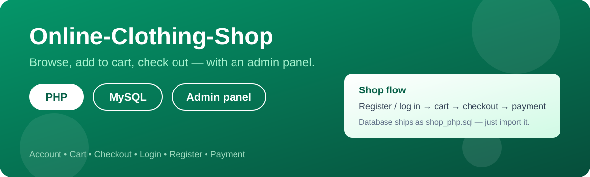
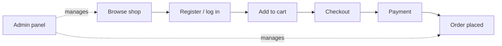

<p align="center">
  
</p>

<p align="center">
  <a href="https://github.com/smabdulmueid97/Online-Clothing-Shop"></a>
  <a href="https://github.com/smabdulmueid97/Online-Clothing-Shop"></a>
  <a href="https://github.com/smabdulmueid97/Online-Clothing-Shop/stargazers"></a>
</p>

<h1 align="center">Online-Clothing-Shop</h1>

<p align="center">
  A PHP + MySQL clothing shop — browse, register, add to cart, check out, and pay.<br />
  An <b>admin panel</b> manages the shop behind the scenes.
</p>

<p align="center">
  <a href="#-what-it-does">What it does</a> •
  <a href="#-how-a-purchase-flows">Purchase flow</a> •
  <a href="#-setup">Setup</a> •
  <a href="#-layout">Layout</a>
</p>

---

## 🛍️ What it does

| Area | What it covers |
|---|---|
| **Register / Login** | Customer accounts — sign up and sign in |
| **Account** | The customer's account area |
| **Cart** | Add items, review the cart before buying |
| **Checkout** | Place the order |
| **Payment** | Pay for the order |
| **Admin panel** | Manage the shop (products, orders, customers) |



## ⚙️ Setup

**Requirements:** PHP and MySQL (e.g. XAMPP, or PHP + MySQL installed separately).

**1. Clone the repo**

```bash
git clone https://github.com/smabdulmueid97/Online-Clothing-Shop.git
cd Online-Clothing-Shop
```

**2. Create the database**

Import [`shop_php.sql`](shop_php.sql) into MySQL — via phpMyAdmin, MySQL Workbench, or the command line:

```bash
mysql -u <your_mysql_username> -p -e "CREATE DATABASE <your_database_name>;"
mysql -u <your_mysql_username> -p <your_database_name> < shop_php.sql
```

**3. Set your database credentials**

Update the database connection settings in the project with **your own** values — these are placeholders, not real credentials:

```
DB host:     <your_host>        e.g. localhost
DB username: <your_username>    e.g. root
DB password: <your_password>
DB name:     <your_database_name>
```

> Never commit real credentials. Keep them in your local setup only.

**4. Run it**

```bash
php -S localhost:8000
# then open http://localhost:8000
```

Or serve the folder through your local stack (e.g. XAMPP's `htdocs`).

## 🗂️ Layout

```
admin_panel/        # shop management — products, orders, customers
shop_php.sql        # database schema + seed data — import this first
```

Plus the shop pages covering account, cart, checkout, login, register, and payment.

## License

No `LICENSE` file in this repo yet — add one to set the terms.
